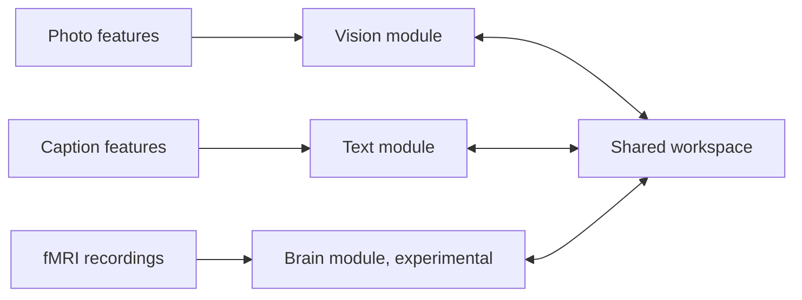

# GLoW cocoBrain

Learning a shared representation for images, text and brain recordings.

I started this project to learn how a model can connect images and text.
The first experiments use photos and captions from COCO.
I then added an fMRI module using NSD, where participants viewed some of those
same images.

**An experimental project, still before V1.** Image and text experiments are in
place. The brain extension is unfinished.

## The idea

A photo and a caption can describe the same scene in very different ways. Each
has its own encoder, which maps it into a shared space called the workspace.
The model learns to bring matching examples together and recover one type of
representation from another.

This makes it possible to test image-to-caption and caption-to-image retrieval.
The aim of the brain extension is to connect fMRI recordings to the same space.
The current model works with feature vectors; the visual examples retrieve
existing images and captions from a dataset.

## What's in the repo

- **Image and text training** using pre-extracted ResNet-50 and E5 features,
  with separate autoencoders and projections into the workspace.
- **Workspace experiments** with contrastive alignment, translation, round trips
  and fusion, including training with only part of the data paired.
- **An fMRI extension** with NSD preprocessing and a brain module trained while
  the image and text modules stay frozen.
- **Evaluation and an analysis notebook** for retrieval, reconstruction losses
  and the geometry of the learned representations.

The [experiment log](DEVLOG.md), written in French, records the changes, failed
runs and results. It also contains older architectures that have since changed.
The last brain experiments report retrieval near chance, and the following run
has no recorded outcome. The fMRI preprocessing also needs a correction to the
matching between recordings and images before new brain results can be evaluated.
The [development guide](docs/development.md#known-nsd-blockers) explains the issue.

## Running experiments

This is a Python and PyTorch research prototype. Training data, extracted
features and model checkpoints are not included in the repository. Preparing
them involves external downloads, substantial storage and local computation.

The [development guide](docs/development.md) covers the current architecture,
COCO preparation, training commands, the NSD extension and known limitations.
Start with the image and text experiment; the fMRI path needs additional data,
preprocessing fixes and validation.

- [Image and text configuration](config/config.yaml)
- [Brain experiment configuration](config/config_brain.yaml)
- [Analysis notebook](notebooks/inference_viz.ipynb)
- [Experiment log](DEVLOG.md)
- [My portfolio](https://victormonnot.com)

## References

The experiments draw on [Semi-supervised Multimodal Representation Learning
through a Global Workspace](https://arxiv.org/abs/2306.15711) and
[Multimodal Dreaming](https://arxiv.org/abs/2502.21142).
